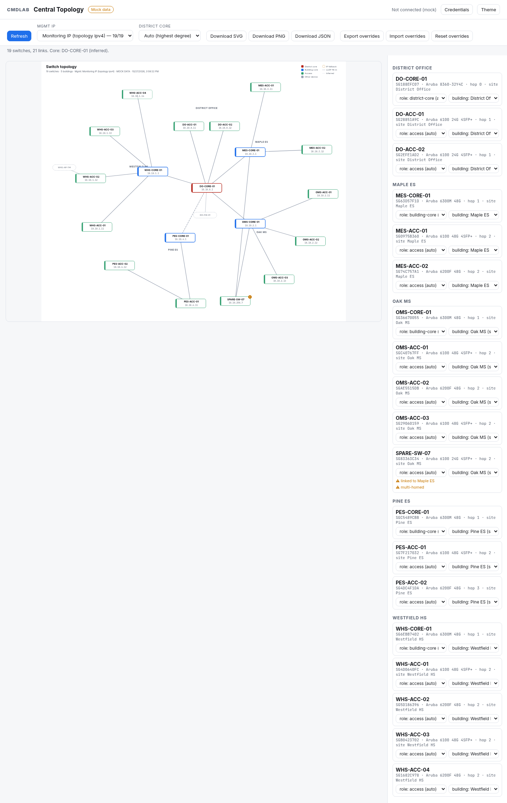

# Central Topology

A switch topology diagram for a new Central (HPE GreenLake) tenant. A layout picker draws the same switches seven ways. Hub and spoke is the default: the district core sits in the middle, each building core is a hub, and access switches are spokes. Each node is labeled with its name and a management IP you choose. You can download the diagram as SVG, PNG or JSON.

- `site/`: a static page with no build step, hosted on Cloudflare Pages.
- `worker/`: a stateless, read-only pass-through on Cloudflare Workers. It holds no credentials. It is new Central only, and the topology API is the inventory source.
- `tests/`: `node --test`. Covers the Worker merge against the fixtures, role inference, management-IP choice, override parsing, layout placement, and the credential model: nothing persisted or logged server-side, and requests without credentials get mock data or a 401.
- `docs/API-NOTES.md`: every Central call with its doc link, which items are unverified, the auth flow, the CORS check, and the management-IP path end to end.
- `TOKEN-RISK.md`: the credential model (bring your own, held in the browser) and its residual risks.

**Hosted preview (mock data):** [central-topology-preview.pages.dev](https://central-topology-preview.pages.dev/)



Status: preview. The hosted preview shows a synthetic district by default. Live data requires the viewer's own read-only new Central API credentials, entered in the browser. No credentials are stored in this repository or in the hosted Worker.

## Credentials: bring your own, held in the browser

Users sign in from the **Credentials** panel. They choose a new Central cluster and enter either the client ID and secret of a new Central personal API client, or a bearer token.

- **Which API client:** in HPE GreenLake, open Manage Workspace > Personal API clients and create a client whose service is your new Central instance. Its credentials work with the new Central token endpoint that this page uses.
- **GreenLake platform (GLP) API clients** are scoped to the workspace rather than to Central. They use a different token endpoint, `https://global.api.greenlake.hpe.com/authorization/v2/oauth2/<workspace-id>/token`, which does not allow browser (CORS) requests. This page does not exchange GLP credentials. A token obtained from that endpoint can be used with Bearer token sign-in; it lasts 15 minutes.

- **Storage:** credentials stay in that browser. They are kept in `sessionStorage` by default, which clears when the tab closes. Ticking **Remember on this device** keeps them in `localStorage` instead. **Forget** clears both.
- **Token:** the browser exchanges the client ID and secret for a token directly with HPE GreenLake. The token endpoint allows CORS; see `docs/API-NOTES.md`.
- **Data calls:** the new Central API does not allow CORS. The browser therefore calls the Worker, sending the token in `Authorization` and the cluster URL in `X-Central-Base`. The Worker relays read-only GETs for that request only. It does not store, cache or log anything, and every response is `Cache-Control: no-store`.
- **URLs:** credentials never appear in a URL or query string.
- **No credentials:** the page shows mock data.

See `TOKEN-RISK.md`.

## Run locally (mock data)

```sh
cd worker
npm install
npm run dev          # wrangler dev --assets ../site: the page and /api/* on one origin
npm test             # node --test ../tests/*.test.mjs
npm run typecheck
```

With no credentials entered and `MOCK=1` (the default in `wrangler.toml`), the Worker answers the same new Central paths from `worker/fixtures/`, a synthetic district of 5 sites and 19 switches. Run `python3 worker/fixtures/gen_fixtures.py` to regenerate them.

## How it works

1. The Worker's `/api/topology` lists sites (`sites-health`) and fetches `topology/{site-id}` for each one. It merges devices and links across sites.
   - If a switch shows up in more than one site, the Worker asks switch detail for its home site.
   - If a switch is still disconnected, it fills the gap from LLDP (`neighbours/{serial}`).
   - It adds VLAN SVI and OOBM/loopback IPs as management candidates.
   - Device group names come from one read-only `GET /network-monitoring/v1/device-inventory` (`items[].deviceGroupName`, matched on `items[].serialNumber`). A blank or missing name stays unset. The same bearer token is used. Nothing from that response is stored or logged.
2. `site/js/model.js` infers roles:
   - The district core is the highest-degree switch, unless you pick one.
   - Building is the site assignment.
   - Each building's core is its switch closest to the district core, measured by BFS hops.
   - Everything else is access.
   - Ambiguous switches are flagged: no site, linked into another building, multi-homed, or no path to the core.
3. Overrides are stored in `localStorage` under `ct-overrides`. You can set the district core, or a switch's building or role, then export or import them as JSON. Those apply in every layout.
4. `layout.js` places nodes. The Layout picker selects one of the seven layouts below; the choice is kept in `localStorage` under `ct-layout`. `render.js` produces one self-contained SVG with colors taken from the `theme.css` tokens.
5. Downloads follow the layout on screen:
   - SVG is that string.
   - PNG is the SVG drawn onto a 2× canvas.
   - JSON has the model, the selected management IP for each switch, the layout id, position overrides, and your other overrides.

## Layouts

The toolbar Layout control redraws the current switches and links. Hub and spoke is the default. Drag a node to pin it; double-click it to let the layout place it again. Pinned positions are stored per layout in `localStorage` under `ct-positions`. Switching layouts leaves every other layout's pins in place. Export overrides writes the pins into the same JSON file; an older file with no pins leaves them as they are.

The header control Show access neighbors is on by default. It is stored in `localStorage` under `ct-show-access-neighbors`, with the same load and save as the layout, theme, and management-IP choices. Turn it off to drop APs and every other LLDP neighbor that hangs off an access switch, including the chips that stand in for them. Every layout, including Grouped by group, is placed again without those nodes and links, and the view fits what remains. Neighbors of the district core and of building cores stay, and so do links between switches.

Hub and spoke sizes the ring to the cluster. A small network pulls each cluster in toward the district core so the fitted view already draws card names at 11px or larger, and that view opens fitted. A larger drawing, whose fit is still below that absolute floor, opens at the floor, centered on the district core, and you pan or press Fit for the rest. It never opens zoomed past fit when fit already meets the floor, and it never opens past the floor. Grouped by site and Grouped by group open at that same 11px name floor. The tiered trees, radial rings, and the force-directed layout still open fitted when that scale stays at least as large as the left-to-right tree in the same pane, and a larger drawing opens at that floor, centered on the district core. Fit, +, and − change the zoom. The title, the detail line, and the legend stay above the pan area. SVG, PNG, and JSON downloads still contain the whole graph.

- **Hub and spoke.** The district core is in the center. Each building is a cluster sized to its cards: access switches toward the core, the building core and its label on the outer edge of that cluster. LLDP neighbors of an access switch collapse to one chip, "+1 AP" or "+N APs", until you zoom in or click the chip.
- **Tiered tree, top-down.** The district core is the root. The next tier is every switch one hop away (the building cores, plus any access switch linked directly to the district core). Access switches sit on the tiers below their parent, so a daisy-chained switch adds a tier. Switches on a tier stay grouped under their parent, with a link that leaves the site placed on the side facing that neighbor. Links run in the gap between tiers.
- **Tiered tree, left to right.** The same tiers, with hops running left to right. It stays readable on a wide viewport, where the depth fits across the page.
- **Radial rings.** Tiers are concentric rings: district core, then building cores, then access switches. Each building's switches share an arc.
- **Grouped by site.** Each site is a labelled box with that site's switches stacked inside. Links that stay in the site run through the gutter beside the box. Links that leave the site run through the lane above the boxes. The boxes wrap across the width of the diagram.
- **Grouped by group.** The same boxes and full-width grid, with one box per Central device group. A switch with no group sits in Ungrouped. The district core keeps its core mark. Links that leave the group are drawn lighter, the same way links that leave a site are. The view opens at the 11px name floor. Show access neighbors uses the same toggle as the other layouts: off removes access-switch neighbor chips and their links, and the boxes are placed again.
- **Force-directed.** Links act as springs and nodes repel. The simulation starts from a fixed seed and stops when it settles, so the same data always produces the same picture. It does not keep moving. The settled graph is centered in the frame, with at least a 16px gap between node boxes.

## Worker endpoints

Data routes are GET only. Live data needs both `Authorization: Bearer <token>` and `X-Central-Base: https://<cluster>.api.central.arubanetworks.com`. Without them, the Worker serves mock data (`MOCK=1`) or returns 401 (`MOCK=0`). The response header `X-Data-Source` is `mock` or `live`. Any credential sent in a query string is ignored.

| Route | Central call(s) |
|---|---|
| `POST /api/token` | Fallback only. It takes a JSON body `{clientId, clientSecret}`, calls the GreenLake token endpoint, and returns `{access_token, expires_in}` to the browser. It keeps nothing |
| `/api/health` | none |
| `/api/sites` | `GET /network-monitoring/v1/sites-health` |
| `/api/sites/:siteId/topology` | `GET /network-monitoring/v1/topology/{site-id}` |
| `/api/switches/:serial/neighbors` | `GET /network-monitoring/v1/neighbours/{serial-number}` |
| `/api/switches/:serial/vlans` | `GET /network-monitoring/v1/switches/{serial-number}/vlans` |
| `/api/switches/:serial/interfaces` | `GET /network-monitoring/v1/switches/{serial-number}/interfaces` |
| `/api/topology?include=vlans,interfaces` | sites-health, device-inventory (group names only), then topology per site, plus switch detail, neighbours, vlans and interfaces as described above |

Doc links for each call are in `docs/API-NOTES.md`.

## Configuration

| Name | Kind | Notes |
|---|---|---|
| `MOCK` | var | `"1"` (default): requests without credentials get fixtures. `"0"`: they get 401 |
| `ALLOWED_ORIGINS` | var | A comma-separated CORS allowlist (the Pages origin) |

There are no secrets, no KV, Durable Object, R2 or D1 bindings, and no Cache API use. `.dev.vars.example` has nothing secret in it.

`site/config.js` maps the page's host name to its Worker URL; on any other host (including `wrangler dev`) the page calls `/api/*` on its own origin. The Worker's `ALLOWED_ORIGINS` must list the page origin.

## Hosted preview

| Component | Name | URL |
|---|---|---|
| Page (Cloudflare Pages) | `central-topology-preview` | https://central-topology-preview.pages.dev/ |
| API (Cloudflare Worker) | `central-topology-preview` | https://central-topology-preview.admin2655.workers.dev/api/health |

The preview Worker runs with `MOCK=1` and has no secrets or storage bindings. It is defined by `[env.preview]` in `worker/wrangler.toml`.

## Deploy your own

```sh
cd worker
npm install
npx wrangler pages project create <pages-project> --production-branch main
# Edit [env.preview] in wrangler.toml (name, ALLOWED_ORIGINS = your Pages origin)
# and the host map in ../site/config.js (your Pages host -> your Worker URL).
npx wrangler deploy --env preview
npx wrangler pages deploy ../site --project-name <pages-project> --branch main
```

No secrets are required. Set `MOCK = "0"` if requests without credentials should receive 401 instead of mock data.
